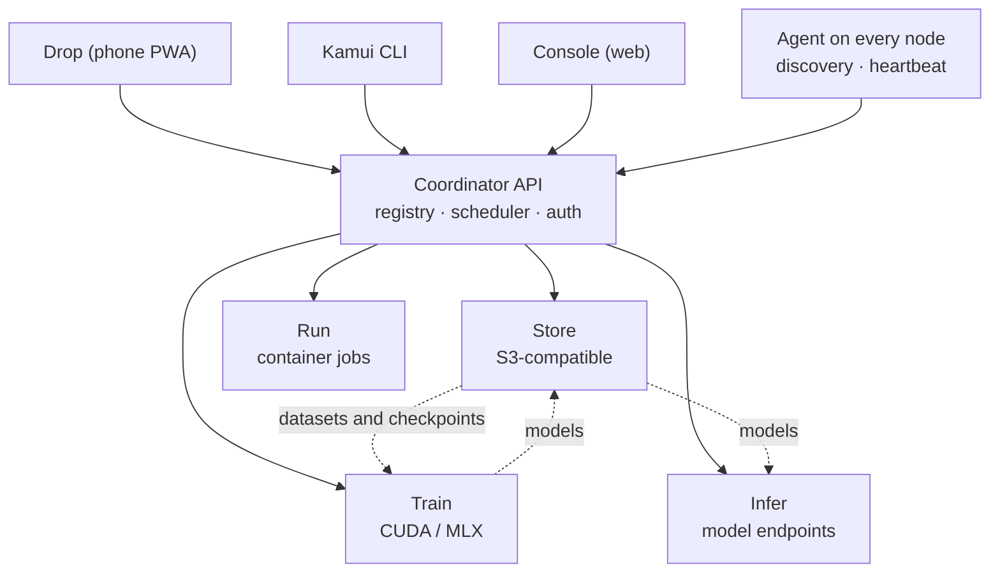

<div align="center">

# Kamui Cloud

**An open-source private cloud built from everyday laptops.**

*Your lab. Your cloud.*

[](LICENSE)


[](CONTRIBUTING.md)

[Overview](#overview) ·
[Services](#services) ·
[Architecture](#architecture) ·
[Tech stack](#tech-stack) ·
[Repository layout](#repository-layout) ·
[Roadmap](#roadmap) ·
[Contributing](#contributing)

</div>

---

## Overview

Kamui turns a handful of ordinary laptops into one private cloud. Storage, compute, model training, model serving and file sharing sit behind **one API, one CLI and one dashboard**.

- **Zero cost.** No cloud bills, no egress fees. Use the hardware you already own.
- **Offline-first.** Everything runs on your local network. The internet is optional.
- **Ephemeral by design.** Laptops come and go. Nodes join with `kamui up` and leave with `kamui down`, and jobs and data are handled safely.
- **Heterogeneous.** Mac (Apple Silicon), Windows, Linux and ARM machines work together in a single scheduler.

> **Status:** Kamui is in early development. The repository currently contains the project skeleton. APIs and structure will change.

## Services

| Service | What it does | Similar to |
|---|---|---|
| **Store** | Files, models and datasets with an S3-compatible API | Amazon S3 |
| **Run** | Run any container or script on a free node | ECS / Lambda |
| **Train** | ML training jobs on free GPU (CUDA) or Apple Silicon (MLX) nodes | SageMaker Training |
| **Infer** | Deploy a model as an API endpoint | SageMaker Endpoints |
| **Drop** | Quick file sharing between phones and laptops | Quick Share / AirDrop |
| **Console** | Web dashboard for nodes, jobs, storage and logs | AWS Console |
| **CLI** | `kamui up`, `kamui down`, `kamui submit` | AWS CLI |

## Architecture



**How a cluster forms**

1. A laptop runs `kamui up`. The agent finds other nodes on the network using mDNS.
2. Each node reports what it can do: RAM, GPU or MLX, free disk.
3. The coordinator keeps a registry of live nodes and schedules jobs on the best fit.
4. `kamui down` drains running jobs and removes the node cleanly.

## Tech stack

> Planned stack. It may change as the project matures.

| Area | Technology |
|---|---|
| Node agent | Rust |
| Coordinator, Store, Run, CLI | Go |
| Train, Infer (ML) | Python (PyTorch, MLX) |
| Console, Drop | TypeScript (Next.js, PWA) |
| Discovery | mDNS |
| API contract | OpenAPI / Protocol Buffers (`shared/`) |
| Packaging | Docker, native binaries |

## Repository layout

```
kamui-cloud/
├── agent/     Node agent: discovery, heartbeat (Rust)
├── api/       Coordinator: registry, scheduler, auth (Go)
├── store/     S3-compatible storage service (Go)
├── run/       Container and job runner (Go)
├── train/     ML training service (Python)
├── infer/     Model serving service (Python)
├── drop/      Quick file sharing PWA (TypeScript)
├── console/   Web dashboard (TypeScript)
├── cli/       The `kamui` command-line tool (Go)
├── shared/    API schemas and shared definitions
├── ops/       Docker Compose, setup and deployment scripts
├── docs/      Documentation
└── .github/   CODEOWNERS, issue and PR templates, workflows
```

Each top-level folder has one owner (see [`.github/CODEOWNERS`](.github/CODEOWNERS)).

## Getting started

Kamui is not usable yet. To set up a development environment:

| Tool | Install |
|---|---|
| Git and GitHub CLI | `brew install git gh` · `winget install Git.Git GitHub.cli` |
| Rust | [rustup.rs](https://rustup.rs) |
| Go | `brew install go` · `winget install GoLang.Go` |
| Docker | OrbStack (Mac) · Docker Desktop (Windows) |
| Python 3.12 and uv | Only for `train/` and `infer/` |
| Node.js LTS | Only for `console/` and `drop/` |

Then clone the repository:

```bash
git clone https://github.com/nimbuslabs-dev/kamui-cloud.git
cd kamui-cloud
```

Read [CONTRIBUTING.md](CONTRIBUTING.md) before you start working.

## Roadmap

- [x] Organization, repository and contribution workflow
- [ ] **M0:** `kamui up`, node discovery and heartbeat
- [ ] **M1:** Store
- [ ] **M2:** Run
- [ ] **M3:** Train
- [ ] **M4:** Console
- [ ] **M5:** Infer
- [ ] **M6:** CLI polish
- [ ] **M7:** Drop

Progress is tracked on the project board and in [Issues](https://github.com/nimbuslabs-dev/kamui-cloud/issues).

## Contributing

Everyone works in their own folder and pushes straight to `main`, so nobody gets conflicts. Please read [CONTRIBUTING.md](CONTRIBUTING.md) for the simple workflow.

## License

Released under the [MIT License](LICENSE).

<div align="center">

Built by **Nimbus Labs**

</div>
