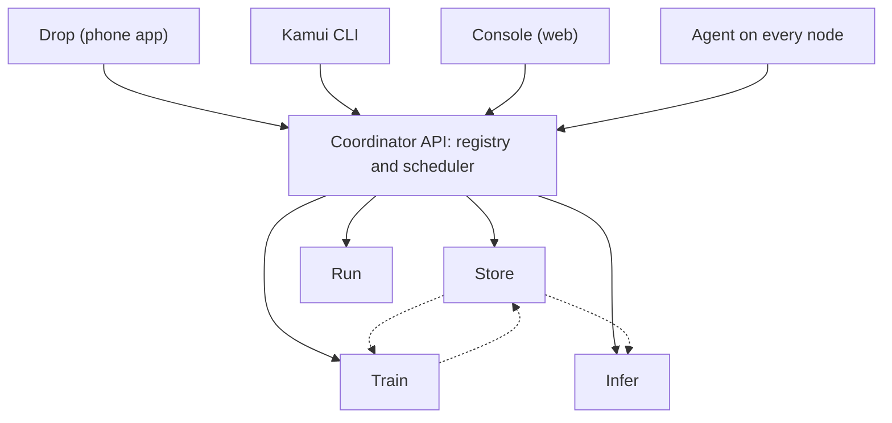

<div align="center">

# Kamui Cloud

**Turn everyday laptops into your own private cloud.**

Storage, compute, model training, model serving and file sharing behind one API, one CLI and one dashboard.

[](LICENSE)


[Overview](#overview) |
[Services](#services) |
[Architecture](#architecture) |
[Tech stack](#tech-stack) |
[Repository layout](#repository-layout) |
[Getting started](#getting-started) |
[Roadmap](#roadmap) |
[Contributing](#contributing)

</div>

---

## Overview

Kamui connects the laptops you already own into one small cloud. A laptop joins with `kamui up`, shows up on the dashboard, and leaves with `kamui down`.

- **Zero cost.** No cloud bills and no egress fees.
- **Offline first.** Everything runs on your local network. The internet is optional.
- **Made for laptops that come and go.** Nodes join and leave, and the cluster keeps working.
- **Mixed hardware.** Mac (Apple Silicon), Windows, Linux and ARM machines work together.

> **Status:** Kamui is in early development. The repository is a skeleton and the first version (v0.1) is being built now. APIs and folder contents will change.

## Services

| Service | What it does | Similar to |
|---|---|---|
| **Store** | Keep files, datasets and models | Amazon S3 |
| **Run** | Run a container or script on a free node | ECS |
| **Train** | Train a machine learning model on a free node | SageMaker Training |
| **Infer** | Serve a trained model as an API | SageMaker Endpoints |
| **Drop** | Send files between phone and laptop | AirDrop |
| **Console** | Web dashboard for nodes, files and jobs | AWS Console |
| **CLI** | The `kamui` command | AWS CLI |

## Architecture



**How a cluster forms**

1. A laptop runs `kamui up`. The agent finds other nodes on the same network using mDNS.
2. The node registers with the coordinator and sends a heartbeat every 5 seconds.
3. The coordinator keeps the list of live nodes. A node with no heartbeat for 15 seconds is marked offline.
4. `kamui down` removes the node cleanly.

## Tech stack

| Area | Technology |
|---|---|
| Node agent | Rust |
| Coordinator API, Store, Run, CLI | Go |
| Train, Infer | Python |
| Console, Drop | TypeScript (Next.js, PWA) |
| API contract | OpenAPI (`shared/openapi.yaml`) |
| Packaging | Docker and native binaries |

The stack is planned and may change as the project grows.

## Repository layout

```text
kamui-cloud/
  agent/     Node agent: discovery and heartbeat (Rust)
  api/       Coordinator: registry and scheduler (Go)
  store/     File storage service (Go)
  run/       Docker job runner (Go)
  cli/       The kamui command (Go)
  train/     Model training (Python)
  infer/     Model serving (Python)
  console/   Web dashboard (TypeScript)
  drop/      Phone file sharing app (TypeScript)
  shared/    API contract
  ops/       Docker Compose and scripts
  docs/      Documentation
  .github/   Issue forms and CI workflow
```

Each folder has its own owner and its own `README.md`.

## Getting started

Kamui is not ready to use yet. To prepare a development machine:

| Tool | Needed for |
|---|---|
| Git and GitHub CLI | everyone |
| Rust (rustup) | `agent/` |
| Go | `api/`, `store/`, `run/`, `cli/` |
| Python 3.12 and uv | `train/`, `infer/` |
| Node.js LTS | `console/`, `drop/` |
| Docker | `run/` and testing |

Clone the repository:

```bash
git clone https://github.com/nimbuslabs-dev/kamui-cloud.git
cd kamui-cloud
```

Default ports: API `8080`, Store `9000`, Run `8082`, Infer `8090`, Console `3000`, Drop `3001`.

## Roadmap

Version 0.1 is built in six short iterations.

- [x] **0. Setup.** Repository, folders, workflow and board.
- [ ] **1. Nodes see each other.** Discovery, registration, heartbeat, `kamui status`, nodes page.
- [ ] **2. Store and Run.** Upload, download and list files. Run a Docker job.
- [ ] **3. Train and Infer.** Train a small model, store it, serve it, get a prediction.
- [ ] **4. Drop and polish.** Send a file from a phone. Improve the dashboard.
- [ ] **5. Release.** Test everything together and tag `v0.1.0`.

After v0.1: saved state and leader election, GPU training (CUDA and MLX), security, logs and graphs, and a public release.

Progress is tracked on the project board and in [Issues](https://github.com/nimbuslabs-dev/kamui-cloud/issues).

## Contributing

Each contributor owns one folder and works only inside it. Changes are pushed straight to `main` in small steps, with the folder name at the start of the commit message:

```bash
git pull
git add agent
git commit -m "agent: add heartbeat"
git pull --rebase
git push
```

Never force push, and never commit secrets, `.env` files, datasets or model files. See [CONTRIBUTING.md](CONTRIBUTING.md) for the full guide.

## License

Released under the [MIT License](LICENSE).

<div align="center">

Built by **Nimbus Labs**. Your lab. Your cloud.

</div>