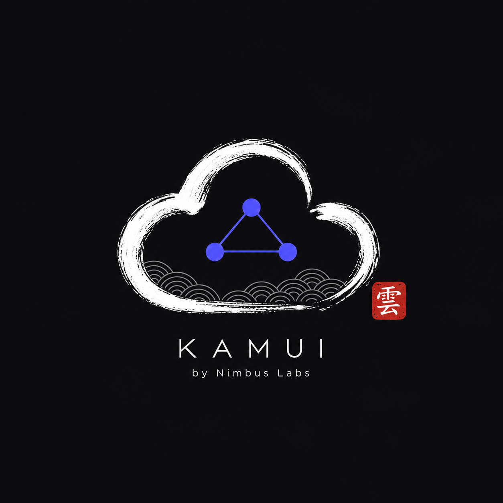
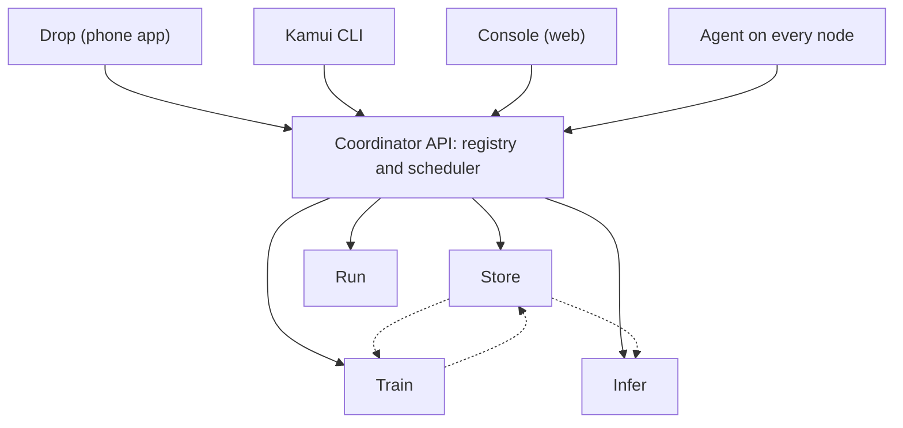

<div align="center">



# Kamui Cloud

*Your lab. Your cloud.*

<br>

**Turn the laptops you already own into one private cloud.**
Storage, compute, model training, model serving and file sharing behind one API, one CLI and one dashboard.

[](LICENSE)


[Why Kamui](#why-kamui) |
[Services](#services) |
[How it works](#how-it-works) |
[Roadmap](#roadmap) |
[Repository layout](#repository-layout) |
[Contributing](#contributing) |
[FAQ](#faq)

</div>

---

> **Status: early development.** The repository is a skeleton and version 0.1 is being built now. Everything marked *planned* below does not exist yet. APIs and folders will change.

## Why Kamui

Every student lab, small team and hackathon group has the same thing: a few good laptops that sit idle most of the day. At the same time, they pay for cloud storage, wait for a free GPU, or send private files through someone else's servers.

Kamui connects those laptops into **one small cloud that you own**.

| | |
|---|---|
| **Free** | No bills, no egress fees. You use hardware you already have. |
| **Private** | Your data stays on your own machines, on your own network. |
| **Offline first** | Everything runs on the local network. The internet is optional. |
| **Made for laptops** | Laptops are not on all day. Nodes join with `kamui up`, leave with `kamui down`, and the cluster keeps working. |
| **Mixed hardware** | Mac (Apple Silicon), Windows, Linux and ARM machines work together. |
| **All in one** | Files, jobs, training and serving through one command and one dashboard. |
| **Open source** | MIT licensed. Any lab can use it, read it and improve it. |

### Where it fits

Kamui is **not** a replacement for AWS, Google Cloud or Zoho. Those run huge data centers for millions of customers. Kamui is for the places where they are too costly, too far away or too much setup.

| | Public cloud (AWS, Google Cloud) | Kamui |
|---|---|---|
| Cost | Pay per use | Free, runs on your hardware |
| Where data lives | Provider's data centers | Your own laptops |
| Internet needed | Yes | No |
| Scale | Almost unlimited | A few to a few dozen machines |
| Setup | Account, billing, permissions | `kamui up` on each laptop |
| Best for | Production apps for the public | Labs, classrooms, teams, hackathons, learning |

### Who it is for

- **Student labs and clubs** that want shared storage and shared compute without a budget.
- **Small teams** that want to keep files and models private.
- **ML learners** who want a place to train and serve models on spare machines.
- **Anyone who wants to learn** how a cloud works by reading and building one.

## Services

| Service | What it does | Similar to |
|---|---|---|
| **Store** | Keep files, datasets and models | Amazon S3 |
| **Run** | Run a container or script on a free node | Amazon ECS |
| **Train** | Train a machine learning model on a free node | SageMaker Training |
| **Infer** | Serve a trained model as an API | SageMaker Endpoints |
| **Drop** | Send files between phone and laptop | AirDrop |
| **Console** | Web dashboard for nodes, files and jobs | AWS Console |
| **CLI** | The `kamui` command | AWS CLI |

## How it works



**How a cluster forms**

1. A laptop runs `kamui up`. Its agent finds other nodes on the same network using mDNS.
2. The node registers with the coordinator and sends a heartbeat every 5 seconds.
3. The coordinator keeps the list of live nodes. A node with no heartbeat for 15 seconds is marked offline.
4. `kamui down` removes the node cleanly.

**A first look at version 0.1** *(planned)*

```bash
kamui up                         # this laptop joins the cluster
kamui status                     # see all nodes
kamui put photo.png              # save a file in Store
kamui run alpine echo hello      # run a Docker job on a free node
```

## Tech stack

| Area | Technology |
|---|---|
| Node agent | Rust |
| Coordinator API, Store, Run, CLI | Go |
| Train, Infer | Python |
| Console, Drop | TypeScript (Next.js, PWA) |
| API contract | OpenAPI (`shared/openapi.yaml`) |
| Packaging | Docker and native binaries |

The stack is planned and may change as the project grows.

## Roadmap

Version 0.1 is built in six short iterations.

- [x] **0. Setup.** Repository, folders, workflow and project board.
- [ ] **1. Nodes see each other.** Discovery, registration, heartbeat, `kamui status`, nodes page.
- [ ] **2. Store and Run.** Upload, download and list files. Run a Docker job.
- [ ] **3. Train and Infer.** Train a small model, store it, serve it, get a prediction.
- [ ] **4. Drop and polish.** Send a file from a phone. Improve the dashboard.
- [ ] **5. Release.** Test everything together and tag `v0.1.0`.

**After v0.1:** saved state and leader election, GPU training (CUDA and MLX), security, logs and graphs, and a public release with a website.

Progress is tracked on the project board and in [Issues](https://github.com/nimbuslabs-dev/kamui-cloud/issues).

## Repository layout

```text
kamui-cloud/
  agent/     Node agent: discovery and heartbeat (Rust)
  api/       Coordinator: registry and scheduler (Go)
  store/     File storage service (Go)
  run/       Docker job runner (Go)
  cli/       The kamui command (Go)
  train/     Model training (Python)
  infer/     Model serving (Python)
  console/   Web dashboard (TypeScript)
  drop/      Phone file sharing app (TypeScript)
  shared/    API contract
  ops/       Docker Compose and scripts
  docs/      Documentation
  .github/   Issue forms and CI workflow
```

Each folder has its own owner and its own `README.md`.

## Getting started

Kamui is not ready to use yet. To prepare a development machine:

| Tool | Needed for |
|---|---|
| Git and GitHub CLI | everyone |
| Rust (rustup) | `agent/` |
| Go | `api/`, `store/`, `run/`, `cli/` |
| Python 3.12 and uv | `train/`, `infer/` |
| Node.js LTS | `console/`, `drop/` |
| Docker | `run/` and testing |

```bash
git clone https://github.com/nimbuslabs-dev/kamui-cloud.git
cd kamui-cloud
```

Default ports: API `8080`, Store `9000`, Run `8082`, Infer `8090`, Console `3000`, Drop `3001`.

## Contributing

Each contributor owns one folder and works only inside it. Changes are pushed straight to `main` in small steps, with the folder name at the start of the commit message:

```bash
git pull
git add agent
git commit -m "agent: add heartbeat"
git pull --rebase
git push
```

Never force push, and never commit secrets, `.env` files, datasets or model files. Read [CONTRIBUTING.md](CONTRIBUTING.md) for the full guide.

## FAQ

**Is Kamui a replacement for AWS or Google Cloud?**
No. It is a small private cloud for labs and teams. It does not try to match the scale of a public cloud.

**What happens when a laptop is closed or leaves?**
The coordinator notices the missing heartbeat and marks the node offline. Jobs and data on that node are unavailable until it comes back. Safer handling of data is planned after v0.1.

**Do I need the internet?**
No. Kamui runs on your local network.

**Can I use it today?**
Not yet. Version 0.1 is under construction. Star the repository to follow along.

## License

Released under the [MIT License](LICENSE).

<div align="center">

Built by **Nimbus Labs**. Your lab. Your cloud.

</div>